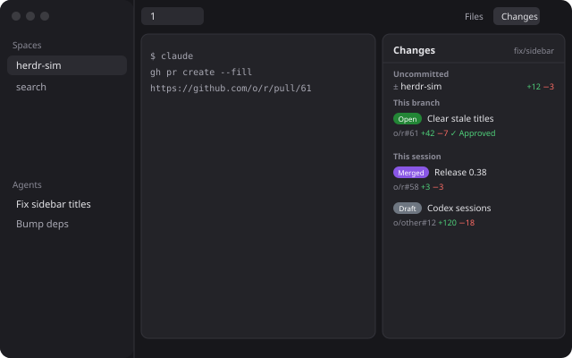

# herdr-sim Changes

herdr-sim's Changes panel in place of the Herdr app's own: beside the focused terminal, the checkouts its Claude Code session left uncommitted and the PRs it touched; a click opens a PR in the browser, and a diff opens wide beside the terminal in herdr-sim's keyboard-driven diff view.

## What you see

- **The tab bar's Changes button** (the shipped `tabs` mod's) opens this panel: it takes the `changes` child of the side panel stack. Files stays as it was. `cmd-shift-c` opens and closes it.
- **The panel**, in the side panel column (368px by default) as a card: 10px radius, 1px `border`, `background`.
  - A 42px header: "Changes" semibold, the focused terminal's branch (11px, `dim`, truncated, right-aligned) and a 12px spinner (`working`) while it looks.
  - "Uncommitted" (11px semibold `dim` heading): a row per checkout with uncommitted changes: `±` (`dim`), the repo, a linked worktree's branch (11px `dim`), then `+a` (`ansi2`) and `−d` (`ansi1`) at the right. Or "No uncommitted changes".
  - "This branch": the branch's PR row, or "No PR for this branch" / "Not on a git branch".
  - "This session": the session's PR rows, newest first, without the branch's PR. When empty it says why: not a Claude Code terminal, no session found, or no PR yet.
  - A PR row: a state pill in GitHub's fixed colours with white 10px text (Open `#238636`, Draft `#6e7681`, Merged `#8957e5`, Closed `#da3633`), the title wrapping beside it; below, `owner/repo#N` (`dim`), `+additions` (`ansi2`), `−deletions` (`ansi1`), "✓ Approved" (`ansi2`) when approved, and a "Diff" button at the right (`muted`, `raised` on hover).
- **The diff**: herdr-sim's diff view in a terminal right of the focused one, while the panel is closed: the selected file's diff beside a tree of the changed files, keys at the bottom.

## How it behaves

- The panel follows the focused terminal (`focused().terminal`, its pane's `cwd` and `branch`). A focused mod pane keeps the last terminal.
- While it is the shown side panel it looks again every 10 seconds and whenever focus moves; hidden, it does nothing, and showing it looks at once.
- An Uncommitted row opens the diff of that checkout (`checkout:<top>`); a PR row opens the PR in the browser (`xdg-open`, else `open`; `explorer` on Windows); a PR row's Diff opens that PR's diff (`pr:<url>`).
- Opening a diff hides the side panel and splits the focused terminal's pane right with `env HERDR_SIM_DIFF_SOURCE=<source> herdr-sim --diff-pane`, focused. Its keys are herdr-sim's: `j`/`k` (or `↓`/`↑`), `Ctrl-d`/`Ctrl-u`, `gg`/`G`, `]`/`[`, `f`/`F`, `Tab`, `z`, `e`, `q`. `q` ends it and its pane closes; once that pane is gone the panel opens again on Changes. A diff whose pane never shows (herdr-sim missing) brings the panel back after 10 s.
- `e` in the diff opens the file in `$VISUAL`/`$EDITOR` at the line, in a terminal right of the diff, zoomed (`herdr-app do terminal.open`, then `pane.zoom`); quitting the editor comes back to the diff.
- `cmd-shift-c` (`sim-prs.toggle`, in `keys.json`'s `layout:main-sim`): open on Changes, with the keyboard in it, when the panel is closed or shows Files; close it when it shows Changes.
- The keyboard: `pane.go` (`cmd-alt-→` from the terminal) moves into the panel (mod.json `focusable`), and so do `cmd-shift-c` opening it and a diff closing. While it has the keyboard its border is `accent` and the selected row `selected` (the first row until one is chosen). `j`/`k` (or arrows) move, `gg`/`G` go to the ends, `Enter` does the row's click (diff for Uncommitted, browser for a PR), `p` opens the PR, `d` its diff (or the checkout's), `Escape` goes back left (`pane.go`).
- Each look is one `herdr-sim --prs-json [--pid <claude pid>] [--cwd <folder>]`, which prints `{ session, changes, branch, prs }`. `changes` covers the terminal's folder and every folder the session worked in, a row per checkout with uncommitted changes (new files' lines counted). herdr-sim keeps PR details between runs by its Changes pane's rule (`fresh`: open PRs 30 s, merged and closed 10 min, a failed fetch 10 min) in `$TMPDIR/herdr-sim/app-prs.json`, and finds the branch PR as its sidebar does (`Cache::branch_state`, keyed `<checkout>#<branch>`) in `app-cache.json`, which also remembers how far each transcript was read.
- A Claude Code terminal (agent `app` `claude-code`) passes its foreground pid (`terminals()[i].foreground.pid`). herdr-sim reads `~/.claude/sessions/<pid>.json`, follows a `/background` job to its session, and lists the transcript's `pr-link` records and the folders its tools worked in.
- A terminal on another machine (`machine/t1`) shows nothing. A Codex terminal shows its folder's changes and branch PR only.
- The keys block removes the old PRs button's `sim-prs` from shared `workspace.panels` once.

## Built from

- **Layout** (`layouts/main-sim.json`): Herdr's `main` 0.1.13, with the `panel-body` stack's `changes` child set to `{ mod: "sim-prs" }`, and `tabs` in a 42px row `tab-bar` beside a 0px block `sim-prs-keys` (`{ mod: "sim-prs", props: { keys: true } }`): it draws nothing but is always shown, so it receives `sim-prs.toggle` and watches for the diff closing. Root `preview` is `layouts/main-sim.svg`.
- **Keys** (`keys.json`): `layout:main-sim` → `cmd-shift-c: sim-prs.toggle`, merged by `scripts/install.sh` without replacing a key the person bound.
- **Mod** `mods/sim-prs/`, built by `tsc` from `src/` (the built `.js` is committed, since Herdr loads it): `main.ts` is the panel and the keys block; `links.ts` holds the `--prs-json` types and pure helpers (`repoOf`, `stateOf`, `splitDiff`), tested under node in `tests/`.
- **herdr-sim**: `--prs-json` (`changes::app_json`, `app_changes`): `claude_session_for_pid`, the Changes pane's `claude_session`, `checkout_of`, `local_diff`, `worktree_branch`, `repo_name`, `fetch_all` and saved-details format. `--diff-pane` (`diff::run`), with `diff::edit_in_app` for `e` in the app.
- **herdr**: `agents`, `panes`, `focused`, `layout`, `theme`, `terminals`, `exec`, `run` (`layout.select`, `layout.show`, `layout.hide`, `pane.split`), `shared` / `setShared` (`workspace.panels`, `sim-prs.diff`), `nextCommand`, `props` (`keys`; `bin`, the herdr-sim to run, default `herdr-sim` on PATH), `window`.
- **Programs**: `herdr-sim` (which runs `git`, `gh pr view` and `gh api graphql`), `herdr-app` (from the diff, for `e`), `xdg-open` / `open`.

## Watch out

- The mod folder is linked, not copied (`scripts/install.sh`). Herdr doesn't draw a mod's own SVGs or images through a link, so the mod ships none; the spinner is the shipped `mods/workspace-chrome/spinner.svg`. Herdr doesn't dock a linked mod either: `place` is `none` and the layout places it.
- A `<mod>.<command>` reaches shown copies only, and a hidden panel's copy may never have started: that's why the 0px keys block exists. It also does the diff watching, since `run()` returns nothing and the diff's pane is only found later, in `terminals()` (argv with `--diff-pane`).
- `pane.split` takes `argv` but no environment: the diff source goes through `env`.
- `--diff-pane` sizes itself and returns to the panel on `q` only in the terminal Herdr (`HERDR_PANE_ID`); in the app the mod does both. `e` can't run the editor inline: the diff's input thread would take its keys.
- `hc get` run from a mod (`hc()` or `exec("hc")`) never returns: take the pid from `terminals()`, which carries `foreground`.
- `fs/promises` may only touch the mod's own folder, and a linked mod's folder is the checkout: anything else goes through `readTextFile` or herdr-sim.
- herdr-sim fails on a flag it doesn't know, so a binary older than the panel says so. Builds from before that ignored unknown flags and printed nothing: the panel reports output it can't parse as "update it", and `scripts/install.sh` checks for the JSON.
- `theme()` is typed `Record<string, string>` while gpui-kit wants `` `#${string}` ``: `main.ts` casts it once. `npm run check` needs the app's own type files, copied by `npm run types`; CI builds with `--noCheck` and fails when the committed `.js` differs from `src/`'s build.
- `init`'s first argument isn't the block's props: read `keys` with `props()`.
- A `<mod>.<command>` reaches every shown copy: the keys block acts on `toggle` only, the panel on `focus` only. The keys block can't focus the panel's copy, so it leaves a time in shared `sim-prs.focus` and the panel takes the keyboard on its next render (in a task, not in `render` itself).
- The keyboard is the active window's: with Herdr behind another app, `pane.go` and focus requests change nothing visible. Test the keys with the window in front.
- Saving a file in the checkout doesn't reload a linked mod; switch layouts (`layout.switch` away and back) to load the new code. `scripts/install.sh` replaces an installed `main-sim.json` only when it is a version this repo committed.
- `herdr-app shot` returns the last drawn frame: with the window covered it can be minutes old. Compare two shots before trusting one.
- Herdr writes `gpui-kit.d.ts` and `jsconfig.json` into every mod folder; `.gitignore` keeps them out.
- Each look runs `git` in every folder the session worked in (about 0.4 s with two repos), every 10 s while shown.
- Claude Code's `pr-link` record is not a documented API and may change.

## Done when

- `npm run check`, `npm test` and `npm run build` (no diff) pass in `herdr-app/`, and `herdr-app check ~/.config/herdr-app/mods/sim-prs` passes.
- `herdr-sim --prs-json --pid <a claude pid> --cwd <dir>` prints that session's changes and PRs.
- The tab bar's Changes opens this panel; `cmd-shift-c` toggles it.
- An Uncommitted row opens the checkout's diff right of the terminal with the panel closed; `q` closes it and the panel comes back.
- A PR row opens it on github.com; its Diff opens the PR's diff.
- `e` in the diff opens the editor zoomed; quitting it shows the diff again.
- With the window in front, `cmd-shift-c` opens the panel with an `accent` border; `j`, `Enter` on an Uncommitted row opens its diff; after `q` the panel has the keyboard again.
